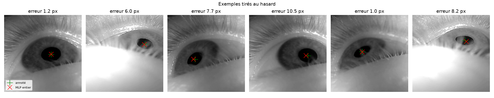
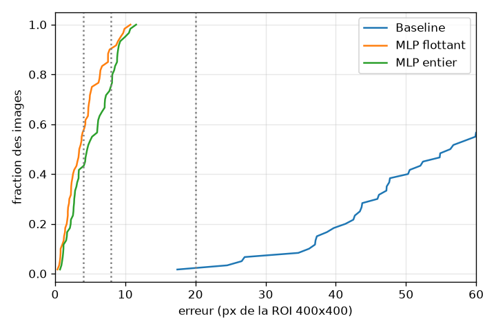

# EyeTrack-FPGA

Localisation de pupille par MLP quantifié : référence Python, modèle fixed-point, inférence VHDL vérifiée bit-à-bit.

## Aperçu
Sur des images d'yeux issues du dataset Swirski, un MLP de 4 266 paramètres atteint une erreur moyenne de **4.06 px** sur une ROI de 400x400. Le modèle quantifié en INT8/INT32 atteint **5.17 px**. Le tout est accéléré en VHDL (4244 cycles par inférence) avec une exactitude bit-à-bit prouvée en simulation.



## Question de recherche
Peut-on localiser la pupille avec un MLP de 4266 paramètres sur des images 16x16 ? Quel est le coût de la quantification INT8 ? Le VHDL peut-il reproduire exactement le modèle entier ?

## Dataset et prétraitement
Dataset [Swirski et al., 2012](https://www.cl.cam.ac.uk/research/rainbow/projects/pupiltracking/). 3 760 images (620x460), 2 participants. ROI fixe 400x400, réduction 16x16 par moyenne de blocs. Cible = centre de l'ellipse / 399. 240 train / 60 val / 276 test (test disjoint par participant). Les données ne sont pas incluses dans ce dépôt.

## Réseau et format fixed-point
MLP 256-16-8-2, ReLU. Poids INT8, activations 0..127, accumulateurs INT32. Requantification `(acc * M + 2^(S-1)) >> S`. Détails dans [docs/fixed_point.md](docs/fixed_point.md).

## Implémentation VHDL
Architecture séquentielle, 1 MAC par cycle. 4244 cycles simulés par inférence. Synthèse GHDL générant les ROMs de poids.

## Vérification
Testbench VHDL vs modèle Python entier : **106 vecteurs synthétiques et 60 vecteurs réels**, **identiques bit-à-bit**. Le test de mutation manuel (modification d'un poids) échoue comme prévu, prouvant la sensibilité du testbench.

## Résultats (Validation)
| Modèle | Erreur moyenne | p95 | < 1% (4 px) |
| --- | --- | --- | --- |
| Baseline | 64.83 px | 109.88 px | 0.0% |
| MLP flottant | 4.06 px | 9.35 px | 56.7% |
| MLP entier INT8 | 5.17 px | 9.97 px | 41.7% |

Écart flottant/entier : moyenne 3.22 px, maximum 5.88 px.
Voir [docs/limitations.md](docs/limitations.md) pour l'analyse de cet écart.



## Reproductibilité
```bash
pip install -r requirements.txt
pip install torch --index-url https://download.pytorch.org/whl/cpu
python -m src.models.train --epochs 1000 --batch 64
python -m src.quantization.quantize
python -m src.evaluation.evaluate --split val
pytest -q
bash scripts/run_vhdl_tests.sh
